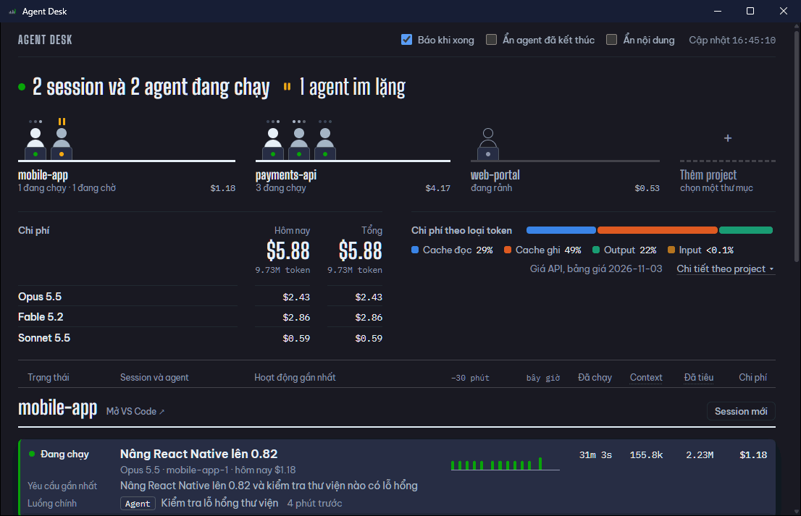

# Agent Desk

Agent Desk là app desktop cho Windows để theo dõi mọi session Claude Code đang chạy trên máy và chat với Claude Code ngay trong app.

Nó dành cho người mở nhiều project trong VS Code, mỗi project một session với nhiều subagent, và phải hỏi từng agent xem việc tới đâu.

- **Theo dõi.** App cho biết mỗi session và subagent đang làm gì, cỡ context, token đã tiêu và chi phí quy theo giá API niêm yết. App báo khi một session xong lượt, khi nó dừng lại chờ bạn trả lời, và khi một agent làm xong. Phần này chỉ đọc file trong thư mục của Claude Code, không ghi gì vào đó, không đọc file đăng nhập, không gửi dữ liệu đi đâu.
- **Nhìn lại.** Trang [Lịch sử](#lịch-sử-chi-phí) cho biết mỗi ngày tốn bao nhiêu, theo project và theo model, và vẫn giữ số liệu sau khi Claude Code xoá transcript cũ.
- **Làm việc.** App [tự mở session Claude Code](#mở-session-và-chat-trong-app) tại thư mục bạn đã xác nhận tin tưởng. Lệnh sửa file hiện thành diff, mỗi yêu cầu xin phép hiện đủ nội dung trước khi bạn duyệt. Session mở trong VS Code thì app chỉ xem, để không có hai nơi cùng ra lệnh.



*Clip dùng dữ liệu mẫu. Hộp chọn thư mục của Windows ở bước thêm project được lược bớt.*

## Dùng

Chạy `agent-desk.exe`. Lần mở đầu mất vài giây vì phải đọc toàn bộ transcript; sau đó app tự quét mỗi 2 giây và chỉ đọc phần mới.

App từng có tên Agent Monitor, file chạy từng là `monitor-agent.exe`. Thư mục dữ liệu vẫn giữ tên `monitor-agent`, nên bảng giá bạn đã sửa, danh sách project, sổ lịch sử chi phí và các công tắc của bản cũ dùng tiếp được. Windows nhận ra app gửi thông báo theo tên file chạy, nên nếu bạn từng tắt hoặc chỉnh thông báo của `monitor-agent.exe` trong **Settings → System → Notifications**, hãy chỉnh lại cho `agent-desk.exe`.

Đầu trang là một khối tổng quan:

- **Dãy bàn làm việc** (bên trái): mỗi project một bàn, mỗi người ngồi là một việc đang diễn ra, gồm luồng chính của session và từng agent chưa xong. Người đang chạy có ba chấm nhấp nháy trên đầu và đèn laptop xanh; đang chờ thì có dấu tạm dừng màu hổ phách; bị chặn vì giới hạn sử dụng thì có vạch ngang và đèn đỏ; session rảnh vẽ bằng nét viền. Dưới mỗi bàn là chi phí của project. Bấm vào một bàn để cuộn tới phần của project đó.
- **Ẩn bớt project:** rê chuột lên một bàn rồi bấm dấu **×** để cất project đó khỏi bảng, cả bàn lẫn khối bên dưới. Chi phí của nó vẫn nằm trong mọi con số tổng và thông báo của nó vẫn đến; ẩn chỉ là không vẽ ra. Cuối dãy bàn có dòng "N project đang ẩn" (kèm số project trong đó đang chạy): bấm vào để xem các bàn đã cất, rồi bấm **Hiện lại** ở bàn muốn đưa về bảng.
- **Quầy chi phí** (bên phải): chi phí hôm nay và tổng chi phí của mọi session trên trang, kèm chi phí theo từng model. Session đã đóng trong hôm nay vẫn được tính, nên tắt một project không làm con số tụt xuống; xem [Chi phí được tính thế nào](#chi-phí-được-tính-thế-nào). Cạnh hai con số là dãy cột của 14 ngày gần nhất, bấm vào để sang trang Lịch sử. Nếu bạn đã đặt ngưỡng chi phí cho một ngày, dưới cột **Hôm nay** có thanh cho biết hôm nay đã tới bao nhiêu phần của ngưỡng.
- **Chi phí theo loại token:** thanh này vẽ theo tiền chứ không theo số token, vì phần lớn token là cache đọc nhưng tiền lại chia khá đều cho cache đọc, cache ghi và output.
- **Nút "Chi tiết theo project"** mở các bảng đầy đủ: token và chi phí theo project, theo loại token, theo model.

Bên dưới là bảng theo dõi:

- **Mỗi project** liệt kê các session của nó, project đang có hoạt động đứng trước. Dòng đầu mỗi khối là session (luồng chính), các dòng dưới là subagent, cùng chung một bộ cột. Dòng tiêu đề cột dính ở đầu khi cuộn.
- **Agent của một workflow** được gom dưới một dòng **Workflow · N agent**. Dòng này ghi các giai đoạn workflow đã qua, số agent đang làm, bị chặn, đã kết thúc, cùng tổng token và chi phí của cả nhóm. Agent đã kết thúc của workflow được thu gọn; bấm vào dòng Workflow để mở hoặc gọn lại. Báo cáo cuối mà agent của workflow trả về dưới dạng có cấu trúc được trình bày theo từng trường, "tên: giá trị".
- **Session đã đóng hôm nay** nằm cuối khối của project, mỗi session một dòng với tiêu đề và chi phí. Bấm vào dòng đó để xem các bước cuối của session, và từ đó [mở lại nó](#mở-session-và-chat-trong-app) nếu muốn làm tiếp. Project không còn session nào chạy nhưng có làm việc trong hôm nay vẫn giữ chỗ trên trang cho tới hết ngày.
- **Ô lọc** ở thanh trên cùng (phím tắt `/`) chỉ để lại những project, session và agent có tên chứa chữ bạn gõ; không phân biệt chữ hoa hay thường, có dấu hay không dấu. Esc xoá chữ đã gõ. Các con số tổng không đổi theo ô lọc.
- **Cột nhịp 30 phút** vẽ số sự kiện mỗi phút trên cùng một trục thời gian cho mọi dòng, nên so được agent nào dừng lúc nào.
- **Bấm vào một dòng** (luồng chính của session hoặc một subagent) để mở khung bên phải với các bước gần đây của agent đó: nhiệm vụ được giao, từng lần gọi tool kèm kết quả, những đoạn nó viết, báo cáo cuối. Khung tự cập nhật theo transcript và chỉ để xem. Với lệnh shell, cả bảng lẫn khung đều hiện câu lệnh thật; câu agent tự mô tả lệnh đó chỉ hiện trong khung, đặt riêng và ghi rõ là lời của agent, như trên thẻ xin phép. Ở đây câu chữ dài được cắt bớt, chuỗi trông như mật khẩu được che, và công tắc **Ẩn nội dung** giấu hết phần chữ, chỉ để lại tên tool. Bấm lại dòng đó để đóng.
- **Tổng kết session:** khi khung bên phải mở một session (luồng chính, session đã đóng hôm nay, hay session do app mở), đầu khung có dòng **Tổng kết session**: số câu bạn gõ, số lần gọi tool, số file đã sửa, số dòng thêm và bớt, số commit và push. Bấm vào để mở bốn nhóm:
  - **Đã làm:** thời gian, câu bạn gõ, các tool hay dùng, thời gian chạy tool, số agent và workflow.
  - **Thay đổi:** các file đã sửa, số dòng thêm và bớt, lệnh `git commit` và `git push` đã chạy không lỗi.
  - **Ai cho phép:** mỗi lần gọi tool do ai cho chạy (bạn, classifier của chế độ auto, chế độ quyền, luật allow, hook), lần nào bị từ chối, session chạy ở chế độ quyền nào.
  - **Vì sao tốn:** số lượt gọi model, phần token dùng để suy nghĩ, mức effort, số lần compact, số lần cache miss và lượng token phải gửi lại, chi phí theo loại agent.

  Thẻ đọc trọn transcript của session và các agent của nó, nên chỉ tính khi khung mở và tính lại tối đa mỗi 30 giây. Nó chỉ đếm, không giữ câu chữ nào; khi bật **Ẩn nội dung**, tên file được bỏ đi, chỉ còn số lượng.
- **Bấm vào tên project** để chuyển sang cửa sổ VS Code đang mở project đó. Lần đầu VS Code có thể hỏi xác nhận việc mở thư mục từ ứng dụng ngoài.

Nếu Windows đang bật "giảm chuyển động" thì hoạt cảnh đứng yên.

Ba công tắc ở góc trên:

| Công tắc | Tác dụng |
|---|---|
| **Báo khi xong** | Báo khi một session xong lượt, khi nó dừng lại chờ bạn trả lời hoặc duyệt, và khi một agent làm xong. Xem [App báo bằng cách nào](#app-báo-bằng-cách-nào). |
| **Ẩn agent đã kết thúc** | Chỉ để lại agent chưa xong: đang chạy, chờ lệnh hoặc im lặng. |
| **Ẩn nội dung** | Dùng khi chia sẻ màn hình. Giấu câu lệnh, yêu cầu và kết quả, cùng những gì gọi tên công việc: tiêu đề session, mô tả agent, tên nhánh, tên giai đoạn của workflow. Bảng khi đó gọi session bằng 8 ký tự đầu của mã session, gọi agent bằng loại agent. Tên project, số liệu và tên tool vẫn hiện. Thông báo cũng bỏ tên session và tên agent. |

Trạng thái của session (dòng đầu mỗi khối) do Claude Code tự ghi: **Đang chạy** khi một lượt đang diễn ra, **Rảnh** khi lượt đã xong, **Chờ bạn** khi session dừng giữa lượt để hỏi bạn hoặc chờ bạn duyệt. Nhãn chờ kèm số phút đã chờ, tính từ lúc Claude Code ghi trạng thái đó. Nếu session đang hỏi bạn bằng một câu hỏi (AskUserQuestion), cột hoạt động ghi **Hỏi bạn** kèm câu hỏi, để bạn biết có cần sang ngay không. Session do app mở mà đang xin phép thì ghi **Chờ bạn cho phép**, vì câu trả lời nằm ngay trong app. Số session đang chờ bạn hiện riêng trong dòng chữ lớn ở đầu trang, kèm thời gian của session chờ lâu nhất. Session hay agent mà lần gọi gần nhất bị từ chối vì giới hạn sử dụng thì ghi **Bị chặn tới HH:MM**; xem [Giới hạn sử dụng](#giới-hạn-sử-dụng).

Trạng thái của agent:

| Trạng thái | Nghĩa |
|---|---|
| Đang chạy | Vừa ghi transcript trong 2 phút gần đây. |
| Chờ lệnh | Đã gọi một tool và chưa có kết quả. Build hay test chạy lâu là bình thường; quá 3 giờ thì coi như đã dừng. |
| Im lặng | 2 đến 15 phút không ghi gì và không chờ tool nào: model đang suy nghĩ lâu, hoặc đã treo. |
| Đã dừng | Im lặng quá lâu mà không kết thúc, nhiều khả năng bị ngắt giữa chừng. |
| Bị chặn | Lần gọi gần nhất bị từ chối vì chạm giới hạn sử dụng, và giới hạn đó chưa mở lại. Agent bị chặn không tự chạy lại khi giới hạn mở. |
| Xong | Đã trả kết quả, hoặc được Claude Code đánh dấu xong. |

### Giới hạn sử dụng

Khi tài khoản dùng hết giới hạn 5 giờ hoặc giới hạn tuần, Claude Code không gọi model nữa mà ghi vào transcript một dòng từ chối, kèm loại giới hạn và giờ mở lại. App đọc dòng đó:

- Dòng của session hay agent ghi **Bị chặn tới HH:MM** (rê chuột để xem ngày), trên bàn người đó có vạch ngang và đèn đỏ, và dưới dòng chữ lớn ở đầu trang có một câu như "Chạm giới hạn tuần: 2 session và 12 agent bị chặn tới 02:00 ngày mai".
- App báo một lần cho mỗi đợt chặn, dù có bao nhiêu agent dính vào, và báo lần nữa khi tới giờ mở lại. Session đang chạy mà bị chặn thì không bị báo nhầm là "đã xong".
- Giới hạn tính theo **tài khoản**. Khi một session cùng tài khoản được model trả lời lại sau lúc bị chặn (giới hạn mở sớm, hoặc bạn đã reset), mọi session của tài khoản đó thôi ghi bị chặn. Session chạy bằng tài khoản khác không ảnh hưởng. App nhận ra tài khoản bằng mã tài khoản mà Claude Code ghi trong transcript (dòng `session-owner`); mã này chỉ nằm trong bộ nhớ của app để gom các session lại, không hiện ra và không được lưu.
- Bản Claude Code cũ không ghi giờ mở lại; khi đó app ghi "chưa rõ tới khi nào" chứ không đoán.

App chỉ biết một giới hạn khi đã có lần gọi bị từ chối. Nó không biết bạn đã dùng bao nhiêu phần trăm giới hạn trước lúc đó.

Hai cột token dễ nhầm:

| Cột | Ý nghĩa |
|---|---|
| **Context** | Kích thước context ở lần gọi API gần nhất. Đây là con số Claude Code hiển thị trong Agent map. |
| **Đã tiêu** | Tổng token đã xử lý qua mọi lần gọi. Mỗi lần gọi gửi lại toàn bộ context, nên số này thường lớn gấp hàng chục lần Context. Chi phí tính theo số này. |

### App báo bằng cách nào

Khi **Báo khi xong** đang bật, app báo mỗi việc theo ba đường cùng lúc, vì không đường nào một mình chắc tới được bạn:

- **Trong cửa sổ app:** một thẻ hiện ở góc dưới bên trái vài giây, và mọi thứ đã báo nằm lại sau nút **Thông báo** ở thanh trên cùng, kèm số cái bạn chưa xem. Bấm vào một dòng để tới project hoặc cuộc trò chuyện mà nó nói tới.
- **Trên taskbar:** nút của app nhấp nháy cho tới khi bạn đưa cửa sổ lên trước. Đường này vẫn thấy được khi cửa sổ đang thu nhỏ.
- **Thông báo của Windows:** bấm vào thì app mở lên và tới đúng chỗ.

Những việc được báo:

- session xong lượt;
- session dừng lại chờ bạn trả lời hoặc duyệt (kèm câu hỏi, nếu session hỏi bằng AskUserQuestion), và nhắc thêm một lần nếu sau 10 phút vẫn chưa ai trả lời;
- agent làm xong trong lúc session còn chạy;
- agent đang làm thì im lặng quá lâu và bị coi là đã dừng;
- agent chờ một lệnh quá 30 phút;
- chi phí trong ngày vượt ngưỡng bạn đặt (một lần mỗi ngày);
- chạm giới hạn sử dụng (một lần cho mỗi đợt chặn), và khi tới giờ giới hạn mở lại;
- session do app mở xin phép.

Lần quét đầu tiên sau khi mở app không báo gì, dù trước đó đã có bao nhiêu việc xong.

**Nếu không thấy thông báo của Windows:** khi thông báo bị tắt, Windows vẫn nhận rồi lặng lẽ bỏ đi, không báo lỗi cho app. App tự đọc ba chỗ quyết định việc đó trong registry (tắt cho mọi ứng dụng, tắt cho riêng app, tắt bằng chính sách của máy) và nói rõ chỗ nào đang tắt ngay trên trang. Hai trường hợp đầu bật lại ở **Settings → System → Notifications**; nếu bị tắt bằng chính sách của máy thì phải nhờ người quản trị máy. Chế độ **Do not disturb** thì app không nhìn thấy được; khi nó đang bật, thông báo nằm trong Notification Center chứ không hiện lên. Dù Windows tắt hay bật, hai đường còn lại vẫn hoạt động.

## Lịch sử chi phí

Tab **Lịch sử** ở thanh trên cùng là thang thời gian thứ hai của app: bảng theo dõi nói ai đang làm gì lúc này, trang này nói mỗi ngày đã tốn bao nhiêu.

- **Biểu đồ:** mỗi ngày một cột, trong 7, 30 hoặc 90 ngày gần nhất. Cột được tô theo project, theo model, hoặc theo loại token. Bốn màu dành cho bốn mục tốn nhất tính trên toàn bộ lịch sử đang có, nên đổi khoảng thời gian không làm một project đổi màu; phần còn lại gộp thành "Khác". Rê chuột lên một ngày (hoặc chọn bằng phím mũi tên) để xem số của ngày đó; bấm vào một ngày để hai bảng bên dưới chỉ còn nói về ngày đó, bấm lại ngày ấy hoặc **Bỏ chọn ngày** để trở về cả khoảng.
- **Chi phí theo kỳ:** hôm nay, tuần này, tháng này. Tuần và tháng chưa hết được đặt cạnh **cùng kỳ** của tuần trước và tháng trước (thứ Hai tới thứ Tư so với thứ Hai tới thứ Tư), vì so với cả kỳ thì kỳ nào chưa hết cũng trông rẻ.
- **Theo project và theo model:** mỗi dòng có dãy cột nhỏ vẽ trên cùng trục thời gian với biểu đồ, nên thấy được project nào làm vào những ngày nào. Mỗi dòng có thang riêng: cột cao nhất là ngày tốn nhất của chính dòng đó.
- **Xem từng ngày dạng bảng:** cùng những con số của biểu đồ, xếp thành bảng.
- **Xuất CSV** ghi khoảng đang xem ra một file do bạn chọn chỗ lưu, mỗi dòng là một ngày, một project và một model, có số token từng loại và chi phí. Dùng để báo cáo hoặc chia chi phí theo project.
- **Báo khi một ngày vượt:** nhập một số USD để đặt ngưỡng cho một ngày. Biểu đồ kẻ ngưỡng đó, quầy chi phí trên bảng cho biết hôm nay đã tới đâu, và app báo một lần khi vượt (cần đang bật **Báo khi xong**). Để trống là không đặt.

**Số liệu lấy từ đâu.** App giữ một sổ riêng, không chứa nội dung hội thoại: mỗi session đã tiêu bao nhiêu token, vào ngày nào, bằng model nào, ở thư mục nào. Sổ được ghi từ hai nguồn. Những session đang hiện trên bảng được ghi liên tục trong lúc chúng chạy. Những session của các ngày trước được đọc một lần từ transcript còn trên đĩa, chạy nền sau khi bảng đã hiện; lần đầu trên một máy mất từ vài giây tới vài phút, các lần sau chỉ đọc session nào có file thay đổi. Claude Code tự xoá transcript cũ sau một thời gian (setting `cleanupPeriodDays` của nó; trên máy thử là khoảng 30 ngày), còn sổ này giữ số liệu tới 400 ngày, nên lịch sử dài dần theo thời gian bạn dùng app.

Sổ không giữ giá. Chi phí của mọi ngày được tính lại theo bảng giá hiện tại mỗi lần hiển thị, nên khi bạn sửa giá một model thì cả quá khứ đổi theo.

## Mở session và chat trong app

Bảng theo dõi chỉ thấy project nào đang có session Claude Code chạy. Để làm việc với một project chưa mở ở đâu cả, thêm nó vào app rồi mở session tại đó.

**Thêm project.** Bấm **Thêm project** (bàn trống có dấu cộng ở cuối dãy bàn) và chọn thư mục. App hỏi một lần xem bạn có tin thư mục đó không. Claude Code do chương trình khác khởi chạy sẽ không tự hỏi câu này, nên hook, MCP server và các quy tắc cấp quyền khai báo trong thư mục có hiệu lực ngay, kể cả quy tắc cho chạy lệnh mà không hỏi. Chỉ đồng ý với thư mục bạn tin tưởng. Project đã thêm luôn hiện trên bảng dù chưa có session; **Bỏ khỏi danh sách** gỡ nó ra mà không đụng tới thư mục. Thư mục mạng dạng `\\máy\thư-mục` chưa được hỗ trợ.

**Mở session.** Bấm **Session mới** ở đầu khối của project. App chỉ mở session ở thư mục bạn đã xác nhận tin tưởng. Nếu project chỉ hiện trên bảng vì đang có session chạy ở đó, app hỏi câu tin tưởng ở trên một lần; bạn đồng ý thì project được thêm vào danh sách. Khung bên phải hiện thư mục session sẽ chạy và file Claude Code sẽ được dùng. Chọn quyền của agent, chọn model nếu muốn, nhập yêu cầu đầu tiên rồi Enter (Shift+Enter để xuống dòng).

| Quyền | Agent được làm gì |
|---|---|
| **Hỏi trước khi sửa file hay chạy lệnh** (mặc định) | Mỗi thao tác có thay đổi đều chờ bạn bấm **Cho phép**. |
| **Tự sửa file, hỏi trước khi chạy lệnh** | Sửa file trong project không hỏi lại; chạy lệnh vẫn chờ bạn. Thế nào là "sửa file" do Claude Code quyết định. |
| **Chỉ đọc và lập kế hoạch** | Agent đọc code rồi đề xuất kế hoạch, không sửa gì. Nếu agent xin thoát chế độ này và bạn cho phép, từ đó nó làm việc như chế độ hỏi trước. |

App không có chế độ "không bao giờ hỏi", và luôn truyền rõ chế độ bạn chọn cho Claude Code. Nếu Claude Code báo nó khởi động ở chế độ khác, do cấu hình của project hay của máy ghi đè, app dừng session đó ngay. Mỗi session mới quay về chế độ hỏi trước; quyền rộng hơn phải chọn lại từng lần.

Có một thứ app không thay bạn kiểm soát được: quy tắc `permissions.allow` và hook đã có sẵn trong `~/.claude` hoặc trong project vẫn cho một số tool chạy mà không hiện thẻ xin phép, y như khi dùng Claude Code trong terminal. Câu hỏi tin tưởng ở trên là để nhắc điều đó.

**Chọn model.** Ô **Model** để sẵn "Mặc định của Claude Code": Claude Code tự chọn theo cấu hình của nó. Các lựa chọn còn lại là model mới nhất của từng dòng model (Fable, Opus, Sonnet, Haiku), chỉ gồm model có giá đánh dấu `verified` trong bảng giá, kèm chi phí ước tính để mở một session bằng model đó. Cũng như quyền, model được chọn lại cho từng session. Nếu Claude Code khởi động bằng model khác với model bạn chọn, hội thoại ghi rõ điều đó.

**Mở lại session đã đóng.** Bấm vào dòng của một session trong mục **đã đóng hôm nay** để xem các bước cuối của nó, rồi bấm **Tiếp tục session này**. Session do app mở và đã kết thúc cũng có nút đó ngay trong khung chat. Session mở lại dưới đúng mã cũ, tại đúng thư mục nó đã chạy, và thư mục đó phải qua câu hỏi tin tưởng như với một session mới; app kiểm tra session có mở lại được không trước khi hỏi. Quyền và model được chọn lại như với một session mới. Claude Code nhớ hội thoại cũ và nạp lại toàn bộ, nên lượt đầu sau khi mở lại tốn hơn một lượt thường; còn khung chat thì bắt đầu trống, muốn xem lại các bước cũ thì xem trước khi bấm. Chỉ mở lại được session còn nằm trong danh sách đã đóng của hôm nay. Session đã chuyển sang thư mục khác giữa chừng (chẳng hạn `cd` vào một thư mục con) vẫn thuộc project nơi nó bắt đầu, và mở lại tại thư mục đó, vì Claude Code lưu transcript theo thư mục ấy.

**Khi agent xin phép,** một thẻ màu hổ phách hiện ngay trên ô nhập và agent đứng chờ cho tới khi bạn bấm **Cho phép** hoặc **Từ chối**. Thẻ được làm theo một nguyên tắc: thứ bạn duyệt là thứ bạn đã thấy.

- Thẻ ghi tên thật của tool.
- Lệnh sửa hoặc ghi file hiện thành diff đỏ/xanh, đủ mọi dòng cũ và mới.
- Với tool khác, thẻ hiện từng trường của yêu cầu, kể cả trường app không biết tên (ví dụ `run_in_background`, `timeout`). Lời agent tự mô tả về lệnh được ghi rõ là lời của agent và đặt sau chính câu lệnh.
- Ký tự không nhìn thấy được (ký tự điều khiển, ký tự rộng bằng không, ký tự đảo chiều chữ) được thay bằng dấu hiện rõ như `␍` hay `⟨U+200B⟩`, và thẻ có dòng cảnh báo.
- Nội dung dài thì phải cuộn hết mới bấm được **Cho phép**. Dài tới mức không hiện hết (trên 200 nghìn ký tự) thì thẻ nói rõ còn thiếu bao nhiêu.
- Hai nút chỉ bấm được sau khi thẻ đứng yên khoảng nửa giây, để một cú bấm nhắm chỗ khác không rơi nhầm vào chúng.

Yêu cầu nào app không đọc được thì app tự từ chối và ghi lại trong hội thoại. Trên bảng, dòng của session đang chờ chuyển sang **Chờ bạn cho phép**. Nếu đang bật **Báo khi xong**, Windows cũng báo cho bạn biết.

**Trong lúc agent làm,** câu trả lời hiện dần theo từng chữ và được dựng theo Markdown (tiêu đề, danh sách, bảng, khối code, trích dẫn, chữ đậm, nghiêng), và dòng cuối khung cho biết nó đang làm gì: đang suy nghĩ, đang viết, đang chạy tool nào. Liên kết trong câu trả lời hiện thành chữ gạch chân chấm, rê chuột lên để xem địa chỉ; không bấm vào được, vì trang giao diện không mở địa chỉ nào. Mỗi lần gọi tool là một dòng, bấm vào để xem đầu vào và kết quả; lần sửa file thì mở sẵn dưới dạng diff. **Dừng lượt này** ngắt lượt đang chạy và giữ session lại để hỏi tiếp. **Kết thúc session** đóng session. **Đóng** (hoặc Esc) chỉ cất khung đi: session vẫn chạy, bấm vào dòng của nó trên bảng (hoặc nút **Mở chat**) để quay lại. Khi có nhiều session, ô chọn ở đầu khung chuyển qua lại giữa chúng.

Vài điều nên biết trước:

- **Session sống cùng app.** Đóng app là kết thúc mọi session app đã mở, vì không còn ai trả lời yêu cầu xin phép của chúng. Lượt đang chạy được yêu cầu dừng trước, rồi mọi thứ session đã khởi chạy (lệnh đang chạy, MCP server, tiến trình nền) bị tắt theo. Trên Windows điều này đúng cả khi app bị tắt đột ngột. Session đã kết thúc trong hôm nay thì mở lại được, xem ở trên.
- **Chi phí mở session.** Mỗi session mới nạp lại system prompt, khoảng 30 nghìn token, giống hệt khi mở Claude Code trong VS Code. Quy theo giá API là khoảng 0,5 USD với Fable 5.2 và 0,1 USD với Sonnet 5.5. Chat tiếp trong session đang mở rẻ hơn nhiều so với mở session mới cho từng câu hỏi.
- **Cấu hình** là của Claude Code trên máy: session dùng hook, MCP server và quyền đã cấp sẵn trong `~/.claude` và trong project, y như một session mở từ terminal. Model cũng vậy, trừ khi bạn chọn một model khác cho session đó.
- **Khung chat không bị che** bởi công tắc **Ẩn nội dung**. Trước khi chia sẻ màn hình, hãy đóng khung chat. (Khung xem bước của agent chạy ngoài app thì vẫn bị che theo công tắc này.)

**App tìm Claude Code ở đâu.** Theo thứ tự: biến môi trường `MONITOR_AGENT_CLAUDE` (đường dẫn đầy đủ tới file `claude`), lệnh `claude` trong `PATH`, bản cài riêng ở `~/.local/bin`, rồi bản đi kèm extension Claude Code của VS Code và các trình soạn thảo cùng họ. Máy nào dùng được Claude Code trong VS Code thì không cần cài gì thêm. File được chọn hiện ngay trong khung **Session mới** trước khi bạn gửi yêu cầu đầu tiên; app không kiểm tra chữ ký số của file đó.

## Chi phí được tính thế nào

Chi phí là **quy đổi theo giá API niêm yết**, tính riêng cho từng loại token (input, output, cache đọc, cache ghi 5 phút, cache ghi 1 giờ) và từng model. Nếu bạn dùng gói subscription, đây không phải số tiền thực trả.

Hai con số ở quầy chi phí cộng những gì:

| Con số | Gồm |
|---|---|
| **Hôm nay** | Mọi lượt gọi API trong ngày hôm nay, của session đang mở lẫn session đã đóng. |
| **Tổng** | Toàn bộ chi phí, từ lúc bắt đầu, của các session trên trang: session đang mở và session đã đóng nhưng có làm việc trong hôm nay. |

Session đã đóng được tính lại từ transcript mà Claude Code để lại trên đĩa, nên tắt một project, hay tắt rồi mở lại app, không làm mất phần đã tiêu trong ngày. Khi có session như vậy, quầy chi phí ghi "Đã tính cả N session đã đóng hôm nay" kèm số tiền của chúng. Sang ngày mới, session đã đóng từ hôm trước rời khỏi trang và **Tổng** giảm theo: đây là tổng của những gì đang hiện, không phải tổng theo tuần hay theo tháng. Số theo ngày, tuần và tháng nằm ở trang [Lịch sử](#lịch-sử-chi-phí).

Bảng giá mặc định nằm trong [internal/pricing/pricing.json](internal/pricing/pricing.json). Các model đánh dấu `verified` cho ra đúng từng số lẻ so với chi phí Claude Code tự ghi lại; các model khác dùng giá input/output công bố với giá cache-đọc giả định, và trang sẽ ghi chú "ước tính".

Để sửa giá hoặc thêm model, tạo file sau:

- Windows: `%AppData%\monitor-agent\pricing.json`
- macOS: `~/Library/Application Support/monitor-agent/pricing.json`
- Linux: `~/.config/monitor-agent/pricing.json`

```json
{
  "models": {
    "claude-opus-5-5": { "input": 4, "output": 20, "cacheRead": 0.20 }
  }
}
```

Giá tính bằng USD cho một triệu token. Chỉ cần ghi model muốn đổi; phần còn lại giữ theo bảng mặc định. Model không có trong bảng vẫn được đếm token nhưng không tính vào chi phí, và trang sẽ báo.

## Quyền riêng tư và an toàn

Transcript chứa source code, câu lệnh, và đôi khi cả mật khẩu hay token từng hiện trong terminal. App xử lý chúng như sau:

- **App không gửi gì đi đâu.** Bản build theo `build.ps1` không mở kết nối mạng nào. Trang giao diện chạy dưới chính sách chặn mọi request ra ngoài và mọi script không thuộc app. Session do app mở là một tiến trình Claude Code bình thường: nó nói chuyện với Anthropic bằng tài khoản Claude Code của bạn, như mọi session khác.
- **Bảng theo dõi chỉ hiện đoạn trích ngắn** (tối đa 180 ký tự) của yêu cầu, câu lệnh và kết quả; không giữ transcript trong bộ nhớ.
- **Che chuỗi trông như thông tin đăng nhập** trước khi hiện trên bảng: `PASSWORD=…` và các tên như `db_password:`, `dbPassword=`, `MYSQL_PWD=`; header `Authorization` và `Cookie`; token trong URL; mật khẩu trong chuỗi kết nối và DSN; cờ mật khẩu của `mysql -p`, `sqlcmd -P`, `curl -u`, `redis-cli -a`, `docker login -p`; khoá AWS, GitHub, GitLab, npm, Stripe, Google; JWT; private key. Đây là so khớp theo mẫu nên không bắt được mọi trường hợp (ví dụ mật khẩu viết lẫn trong câu văn); khi chia sẻ màn hình hãy bật **Ẩn nội dung**.
- **Khung xem bước của một agent** hiện nhiều hơn bảng (vài dòng cho mỗi đoạn văn và mỗi kết quả tool, khoảng 120 bước gần nhất) nhưng vẫn qua cùng bộ che ở trên, và theo công tắc **Ẩn nội dung**.
- **Khung chat không che gì.** Thẻ xin phép hiện đủ nội dung của yêu cầu, vì thứ bạn duyệt phải là thứ bạn đã thấy; hội thoại hiện câu chữ của agent như nó viết, chỉ cắt bớt đầu vào và kết quả tool quá dài. Câu trả lời được dựng Markdown bằng cách tạo từng phần tử và điền chữ vào, không bao giờ qua HTML; bảng quá lớn hay dòng quá dài thì hiện nguyên văn, để một câu trả lời cố tình viết xấu không làm đơ trang trong lúc bạn cần bấm duyệt. App giữ tối đa 600 mục gần nhất của mỗi cuộc trò chuyện trong bộ nhớ và không ghi chúng ra đĩa; bản ghi đầy đủ là transcript do chính Claude Code lưu.
- **File app tạo ra:** hồ sơ WebView2 trong `%LocalAppData%\monitor-agent` (trong đó có các công tắc, ngưỡng chi phí và danh sách project bạn đã ẩn); danh sách project đã thêm trong `%AppData%\monitor-agent\projects.json`; sổ lịch sử chi phí trong `%AppData%\monitor-agent\history.json`; và khi bật thông báo thì một mục đăng ký thông báo trong registry của user hiện tại. File CSV chỉ được ghi khi bạn bấm **Xuất CSV**, ở chỗ bạn chọn trong hộp thoại của Windows. App không tự ghi gì vào `~/.claude`; session do app mở thì ghi transcript của nó vào đó như mọi session Claude Code.
- **Sổ lịch sử không chứa nội dung hội thoại.** Mỗi session một mục: mã session, thư mục nó chạy, và số token theo ngày và theo model. Không có tiêu đề, yêu cầu, câu lệnh hay kết quả nào trong đó. Vì đường dẫn thư mục có trong file, hãy coi nó nhạy cảm ngang `projects.json`. Xoá file này thì lịch sử được dựng lại từ transcript còn trên đĩa, và những ngày mà transcript đã bị xoá sẽ mất.
- **File lịch sử được ghi an toàn,** vì một phần số liệu trong đó không còn nguồn nào khác. App ghi trọn bản mới và đẩy xuống đĩa rồi mới thay bản cũ. File đọc được nhưng hỏng nội dung thì được cất sang `history.json.bak`, không bị ghi đè. Nếu lúc mở app không đọc được file (đang bị chương trình khác giữ, ổ mạng chập chờn) hoặc file do bản app mới hơn ghi, app để nguyên file suốt lần chạy đó và báo trên trang.
- **Session chỉ mở được ở thư mục bạn đã xác nhận,** mở mới hay mở lại cũng vậy. Việc xác nhận là một hộp thoại của hệ điều hành do phần Go hiện ra, không phải của trang giao diện, và phần Go kiểm tra lại danh sách đó mỗi lần mở session. Trang giao diện cũng chỉ nhắm tới được project có trong bảng (kể cả project bạn đang ẩn), và chỉ mở lại được session mà bảng đang liệt kê là đã đóng hôm nay. Tên model và mã session được kiểm tra trước khi tới dòng lệnh của Claude Code: model phải là một trong các lựa chọn app đưa ra, mã session phải đúng dạng UUID.
- **App đọc registry của Windows ở ba chỗ** để biết thông báo có đang bị tắt không (xem [App báo bằng cách nào](#app-báo-bằng-cách-nào)); ba chỗ này chỉ đọc, không sửa.

Giới hạn của các lớp bảo vệ này cần nói thẳng: từ khi app mở được session, trang giao diện là bên bấm **Cho phép**. Nếu có ai chạy được mã của họ bên trong trang (chính sách chặn script lạ và việc không bao giờ dựng HTML từ chuỗi là để ngăn chuyện này), họ có thể mở session ở một thư mục bạn đã tin tưởng và tự duyệt yêu cầu của nó. Ở bản chỉ theo dõi, trường hợp xấu nhất tương ứng chỉ là lộ thứ đang hiện trên màn hình.

App đọc những file sau trong thư mục cấu hình của Claude Code (`~/.claude`, hoặc `CLAUDE_CONFIG_DIR` nếu có đặt):

| Đường dẫn | Dùng để |
|---|---|
| `sessions/<pid>.json` | Biết session nào đang chạy, ở thư mục nào, trạng thái gì và đổi trạng thái từ lúc nào. Mục của process đã thoát bị bỏ qua. |
| `projects/<project>/<session>.jsonl` | Transcript luồng chính: tiêu đề, yêu cầu gần nhất, token từng lần gọi, lần bị từ chối vì giới hạn sử dụng, và mã tài khoản (chỉ để biết session nào chung một giới hạn; không hiện, không lưu). |
| `projects/<project>/<session>/subagents/**/agent-*.jsonl` và `.meta.json` | Transcript và mô tả của từng subagent, kể cả agent do workflow sinh ra. |

Để dựng lịch sử, app còn đọc transcript của những session đã đóng từ các ngày trước, cũng trong `projects/`, mỗi file một lần cho tới khi file đó thay đổi. Từ những file ấy app chỉ lấy số token, ngày, model và thư mục.

Thẻ **Tổng kết session** đọc trọn transcript của một session và các agent của nó khi bạn mở session đó trong khung bên phải. Từ đó app chỉ lấy số đếm (lần gọi tool, dòng thêm bớt, ai cho phép, token…) và đường dẫn của các file đã sửa; những thứ này nằm trong bộ nhớ, không ghi ra đĩa.

Định dạng các file này là nội bộ của Claude Code và có thể đổi theo phiên bản (app được viết và kiểm với bản 2.1.322). Parser bỏ qua thứ nó không hiểu thay vì báo lỗi, và trang sẽ cảnh báo nếu có lượt gọi không cộng được. Nếu số liệu bỗng thiếu sau khi nâng Claude Code, chỗ cần xem là [internal/parse](internal/parse/parse.go).

## Build từ source

Cần Go 1.21 trở lên (lệnh `go` tự tải đúng toolchain ghi trong `go.mod`), Node.js 18 trở lên (nên dùng bản LTS còn được hỗ trợ) và [Wails v2](https://wails.io) cùng phiên bản với `go.mod`:

```
go install github.com/wailsapp/wails/v2/cmd/wails@v2.17.1
```

Build bản để gửi đi:

```
.\build.ps1
```

Script chạy `go vet`, chạy test, rồi `wails build -clean -trimpath -webview2 error`, và in mã SHA-256 của file exe để người nhận đối chiếu. Cờ `-webview2 error` khiến app báo lỗi thay vì tự tải bộ cài WebView2 khi máy thiếu (Windows 11 có sẵn).

Các lệnh khác:

```
go test ./internal/...
go run ./cmd/dump          # in cùng số liệu ra terminal, để đối chiếu
go run ./cmd/dump -history 30   # chi phí từng ngày trong 30 ngày, đọc thẳng từ transcript
go run ./cmd/agentprobe    # thử giao thức với Claude Code thật (tốn token thật)
wails dev                  # chạy thử, tự nạp lại khi sửa code
```

`wails dev` mặc định **không đọc dữ liệu thật và khoá việc mở session**: máy chủ dev của Wails nhận kết nối từ mọi trang web đang mở trong trình duyệt trên máy, và một trang như vậy gọi được mọi lệnh của app, kể cả mở session rồi tự duyệt yêu cầu của nó. Đặt `CLAUDE_CONFIG_DIR` tới một thư mục mẫu để xem bảng theo dõi (việc mở session vẫn khoá). Chỉ `MONITOR_AGENT_DEV_REAL_DATA=1` mới mở cả dữ liệu thật lẫn việc mở session; dùng khi bạn chấp nhận rủi ro đó. Bản build bằng `build.ps1` không có máy chủ này.

Bản macOS phải build trên máy Mac.

## Cấu trúc

```
internal/scan     tìm session đang chạy và file transcript của chúng
internal/parse    đọc transcript tăng dần, cộng token, lấy hoạt động gần nhất; đọc các bước cuối của một agent
internal/clean    làm sạch và che chuỗi nhạy cảm trước khi hiển thị; làm hiện ký tự ẩn trong nội dung chờ duyệt
internal/fsx      mở file sao cho không cản trở Claude Code đang ghi; kiểm tra thư mục trước khi chạy gì ở đó
internal/usage    kiểu dữ liệu đếm token
internal/pricing  bảng giá và phép tính chi phí (số nguyên, đơn vị 1e-9 USD)
internal/history  sổ lịch sử: token theo session, ngày và model; đọc và ghi history.json
internal/monitor  ghép tất cả thành dữ liệu cho màn hình, phát hiện việc vừa xong, dựng lịch sử theo ngày
internal/agent    chạy session Claude Code của app: khởi chạy, gửi yêu cầu, chuyển yêu cầu xin phép
internal/projects danh sách project người dùng đã thêm
app.go, main.go   cửa sổ Wails, vòng quét nền, thông báo, các lệnh của khung chat
notify_windows.go kiểm tra Windows có đang tắt thông báo không, nhấp nháy nút trên taskbar
frontend/         giao diện (TypeScript thuần, không framework); khung chat ở src/chat.ts,
                  trang lịch sử ở src/history.ts, Markdown ở src/markdown.ts
cmd/dump          công cụ dòng lệnh để kiểm tra số liệu
cmd/agentprobe    công cụ dòng lệnh để thử giao thức với Claude Code
```

Các package trong `internal/` không phụ thuộc Wails và có test riêng.

## Giới hạn đã biết

- Bảng theo dõi chỉ nhìn trong phạm vi **hôm nay**: session đang mở, và session đã đóng nhưng có làm việc trong ngày. Các ngày trước chỉ có ở trang Lịch sử, và chỉ là số: không xem lại được session của những ngày đó.
- Lịch sử bắt đầu từ ngày xa nhất mà transcript còn trên đĩa lúc app đọc lần đầu; những gì Claude Code đã xoá trước đó thì không còn cách nào biết. Chi phí trong lịch sử luôn tính theo bảng giá hiện tại, kể cả cho những ngày mà giá thật khi đó khác.
- Session đã đóng hiện tiêu đề, chi phí và các bước cuối của luồng chính; các agent của nó không được liệt kê từng dòng. Nếu Claude Code chưa kịp đặt tiêu đề thì dòng đó ghi "Session chưa có tiêu đề".
- App không nhìn thấy chế độ **Do not disturb** của Windows, nên không cảnh báo được khi thông báo bị chế độ đó giữ lại. Việc nhấp nháy taskbar và việc kiểm tra thông báo bị tắt mới có trên Windows.
- Project đã ẩn, ngưỡng chi phí và các công tắc được nhớ trong hồ sơ WebView2 của máy này; cài lại hoặc xoá hồ sơ đó thì chúng trở về mặc định.
- Khung chat nói chuyện với Claude Code theo cách các Agent SDK chính thức vẫn làm (JSON từng dòng qua stdin/stdout). Luồng tin nhắn có tài liệu; riêng các tin điều khiển dùng cho xin phép và ngắt lượt thì không được công bố như một giao thức cho chương trình ngoài, nên có thể đổi theo phiên bản (đã kiểm với bản 2.1.322). Nếu sau khi nâng Claude Code mà thẻ xin phép không hiện hoặc nút **Dừng lượt này** không ăn, chỗ cần xem là [internal/agent/protocol.go](internal/agent/protocol.go). Một yêu cầu xin phép mà app không đọc được thì bị app từ chối, không bao giờ được trả lời "cho phép".
- Chỉ chat được với session do app mở hoặc mở lại. Chỉ mở lại được session đã đóng trong hôm nay; khung chat của session mở lại không hiện lại hội thoại cũ (xem các bước cũ ở dòng của session trên bảng trước khi mở lại). Chưa chọn được mức effort cho session.
- App không ngăn được một session nó đã mở lại bị mở thêm lần nữa ở nơi khác, chẳng hạn trong VS Code. Khi đó bảng ghi "mở ở hai nơi" và số liệu chỉ được cộng một lần, nhưng hai nơi cùng ra lệnh cho một session thì bạn phải tự tránh.
- Việc tắt hết tiến trình con khi app bị tắt đột ngột dựa vào Job Object của Windows. Trên macOS và Linux, app tắt được cả nhóm tiến trình khi kết thúc session bình thường, nhưng không làm được điều đó nếu chính app bị tắt đột ngột.
- App không kiểm tra chữ ký số của file Claude Code mà nó chạy; đường dẫn của file hiện trong khung **Session mới** để bạn tự đối chiếu.
- Khung chat dựng Markdown thông dụng; không dựng hình, HTML hay công thức, và liên kết không bấm được.
- Một agent "Im lặng" không chắc là treo: model đang suy nghĩ lâu cũng không ghi gì vào transcript.
- Con số Context có thể lệch vài trăm token so với Agent map ở một số agent.
- Nút mở VS Code dùng đường dẫn `vscode://`, nên chỉ mở VS Code bản chính thức, không mở Cursor hay các bản khác.
- Trên macOS và Linux, app chỉ kiểm tra pid còn sống, không kiểm tra được pid có bị process khác dùng lại hay không. Thông báo và nút mở VS Code mới được thử trên Windows.
- Giá cho chế độ fast được nhân theo hệ số công bố cho input/output; phần cache ở chế độ này là giả định.
- File exe chưa ký số, nên Windows SmartScreen sẽ cảnh báo khi mở lần đầu trên máy khác. Trước khi phát rộng trong công ty, nên ký bằng chứng thư của công ty hoặc phát qua kho nội bộ kèm mã SHA-256.

## Bản quyền

© 2026 Khoa Nguyen · [khoabug.com](https://khoabug.com/) · [LinkedIn](https://www.linkedin.com/in/khoanguyenit/)

Dòng này cũng nằm ở cuối cửa sổ app. Bấm vào một trong hai liên kết thì trang tương ứng mở trong trình duyệt mặc định; hai địa chỉ được ghi cố định trong phần Go, trang giao diện không mở được địa chỉ nào khác.
